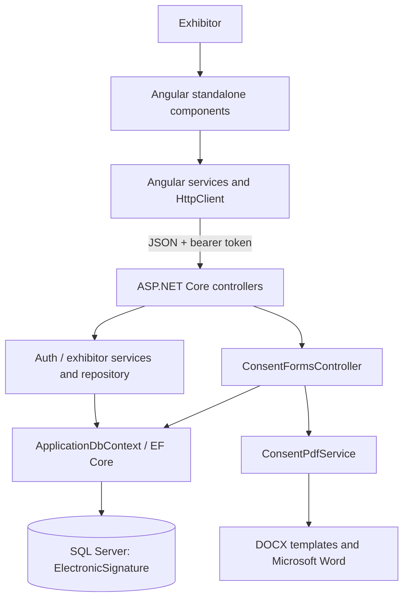

# ElectronicSignature

Texas Youth Animal Showcase exhibitor portal: an Angular application for exhibitor accounts, profiles, and Junior/Open consent-form submissions, backed by an ASP.NET Core API and SQL Server.

## What is implemented

- Exhibitor registration and login using email/password and JWT bearer authentication.
- Junior and Open exhibitor consent flows with step-by-step validation.
- Draw, type, or upload a signature image/name and submit it with a consent form.
- Profile retrieval and editing, submission history, and generation/download of a completed consent PDF.

The signature feature captures an electronic signature. **The current implementation is an electronic signature capture mechanism, not a certificate-based cryptographic digital signature.**

## Technology stack

| Area | Technology |
|---|---|
| Frontend | Angular 22.1, TypeScript 6, RxJS 7, standalone components, reactive forms |
| Backend | ASP.NET Core / .NET 10, C# |
| Persistence | Entity Framework Core 10, SQL Server LocalDB, EF migrations |
| Authentication | JWT bearer tokens; browser storage keys `tas-jwt` and `tas-user` |
| PDF generation | Open XML template editing and Microsoft Word automation on Windows |

## Architecture



The Angular app is in `frontend\electronic-signature-ui`; the API is in `backend\ElectronicSignature.API`. See [docs/ARCHITECTURE.md](docs/ARCHITECTURE.md) for component and request flows.

## Project structure

```text
Assets\                              Consent DOCX templates and design assets
backend\ElectronicSignature.API\     ASP.NET Core API, models, migrations, services
frontend\electronic-signature-ui\    Angular exhibitor portal
frontend\cdk-drag-drop-practice\     Separate Angular practice project
docs\                                Project and developer documentation
graphify-out\                        Generated code knowledge graph
```

## Local setup

Prerequisites: Node.js/npm, .NET 10 SDK, SQL Server LocalDB, and (for PDF conversion) Microsoft Word on Windows.

### Database and API

From PowerShell:

```powershell
cd .\backend\ElectronicSignature.API
dotnet restore
dotnet ef database update
dotnet run --launch-profile http
```

The development connection string targets `(localdb)\MSSQLLocalDB`, database `ElectronicSignature`. The launch profile uses `http://localhost:5022`; Swagger is enabled in Development. The project does not apply migrations automatically at startup. If `dotnet ef` is unavailable, install the .NET EF tool before running the migration command.

### Frontend

In another terminal:

```powershell
cd .\frontend\electronic-signature-ui
npm install
npm start
```

Open `http://localhost:4200`. The configured API base URL is in `src\environments\environment.ts`; the consent service currently uses its own `http://localhost:5022/api/ConsentForms` URL.

## Authentication and consent workflow

Registration creates an exhibitor account; it does not log the user in. After login, the API returns a JWT and exhibitor type. The login page routes `Junior` accounts to `/consent/junior` and `Open` accounts to `/consent/open`. Authenticated users can also visit `/dashboard`, `/profile`, and `/my-submissions`.

Consent form data and signature data are posted to `POST /api/ConsentForms`, associated server-side with the authenticated user, and stored in `ConsentForms`. The UI then navigates to My Submissions. The actual endpoint list and data shapes are in [docs/API_DOCUMENTATION.md](docs/API_DOCUMENTATION.md); authentication details are in [docs/AUTHENTICATION.md](docs/AUTHENTICATION.md).

## Digital signature overview

`DigitalSignatureComponent` offers:

- **Draw:** HTML canvas strokes exported with `canvas.toDataURL('image/png')`.
- **Type:** the entered name, emitted as `fullName` with an empty `dataUrl`.
- **Upload:** PNG/JPEG selected in a browser file input, checked for declared MIME type and a maximum 2 MiB size, then read as a data URL.

The selected signature travels through an Angular output to the consent form and is stored in `ConsentForm.SignatureMethod` and `ConsentForm.SignatureData`. Detailed implementation and limitations: [docs/DIGITAL_SIGNATURE.md](docs/DIGITAL_SIGNATURE.md).

## Documentation

- [Project overview](docs/PROJECT_DOCUMENTATION.md)
- [Architecture](docs/ARCHITECTURE.md)
- [Authentication and registration](docs/AUTHENTICATION.md)
- [Consent forms](docs/CONSENT_FORM.md)
- [Digital signature](docs/DIGITAL_SIGNATURE.md)
- [API reference](docs/API_DOCUMENTATION.md)
- [Database](docs/DATABASE_DOCUMENTATION.md)
- [Frontend](docs/FRONTEND_DOCUMENTATION.md)
- [Backend](docs/BACKEND_DOCUMENTATION.md)
- [Developer setup](docs/DEVELOPER_SETUP.md)

## Current limits worth knowing

- JWTs are stored in `localStorage`; the route guard checks only that a token exists. The API performs actual token validation.
- The checked-in JWT settings include a development fallback/key and must not be used as production secrets.
- Signature uploads are validated in the browser only; no cryptographic identity proof, document hash, certificate, or tamper-evident signature is implemented.
- `POST /api/ConsentForms/{id}/approve` is authorized for any authenticated user but restricts the submission lookup to that same user; it generates a PDF and changes that user's submission status to `Approved`. It is not an administrator-review workflow.
- Password reset, Google sign-in, and the displayed Terms/Privacy links are not wired to working flows in the inspected frontend.

