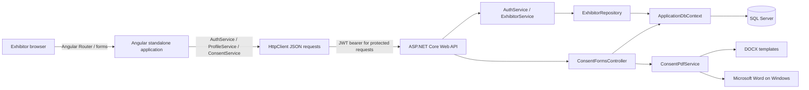
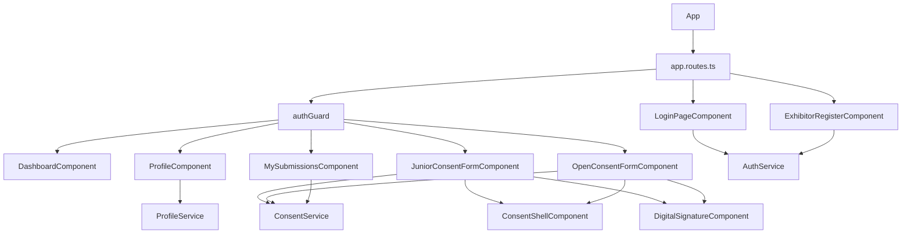

# Architecture

## System context

## Frontend structure

The Angular entry point is `frontend\electronic-signature-ui\src\main.ts`, which calls `bootstrapApplication(App, appConfig)`. `app.config.ts` provides browser global error listeners, `HttpClient`, and the routes. `App` renders a `RouterOutlet`.

The route table is in `src\app\app.routes.ts`. Presentation components live under `src\app\presentation`; online API models/services are under `src\app\online`; the auth guard and consent service are under `src\app\core`.

The shell uses `@Input` properties to render shared navigation/stepper state and emits `back` and `next` outputs. The consent components own their form state and implement the step validation. The signature child accepts heading/description inputs and emits `signatureSaved` or `signatureCleared`.

## API layers

- `AuthController` delegates credential operations to `IAuthService` and registration to `IExhibitorService`.
- `ExhibitorsController` delegates profile read/update to `IExhibitorService`, backed by `IExhibitorRepository`.
- `ConsentFormsController` directly uses `ApplicationDbContext` for create/list/update and calls `IConsentPdfService` to generate PDFs.
- `ConsentPdfService` is registered as a singleton; it serializes Word automation using a static semaphore.

There is no consent repository/service layer between `ConsentFormsController` and `ApplicationDbContext`.

## Request and identity flow

1. Angular posts login or registration JSON to `/api/Auth`.
2. On login, the API verifies the stored password hash and creates a JWT.
3. Angular stores the token and a display/user profile in `localStorage`.
4. The profile and consent services attach the token to protected requests; no global HTTP interceptor is configured.
5. ASP.NET Core JWT middleware checks issuer, audience, expiry, and signing key before `[Authorize]` actions run.
6. Consent create/list actions derive the account identifier from `ClaimTypes.NameIdentifier`; create overwrites client-provided `UserId`.
7. EF Core writes or queries `ConsentForms` in SQL Server.

`AuthService` puts email in `sub`/email claims and a numeric account id in a separate `userId` claim. Consent form ownership uses the name-identifier claim (the JWT subject/email); profile actions parse the custom numeric `userId` claim.

## Persistence

`ApplicationDbContext` exposes `Exhibitors` and `ConsentForms`. EF convention maps these to tables of the same plural names. `AppUser` exists as a model but is not a `DbSet` and is not used by the active authentication flow. The `ConsentForm.UserId` value is a string; there is no configured EF relationship or foreign key to `Exhibitors`.

Development uses SQL Server LocalDB database `ElectronicSignature`. EF migrations are present, but `Program.cs` does not run migrations during startup.

## Configuration and operational boundaries

- API project target: `net10.0`; development launch profile: `http://localhost:5022`.
- Angular API base URL: `src\environments\environment.ts`; `ConsentService` separately hardcodes its consent API URL.
- CORS allows `http://localhost:4200` and `https://localhost:4200`, any headers and methods.
- `UseHttpsRedirection`, CORS, authentication, authorization, and controller mapping are configured in `Program.cs`.
- PDF export depends on Microsoft Word installed on a Windows server. The generation code explicitly throws on non-Windows systems.

