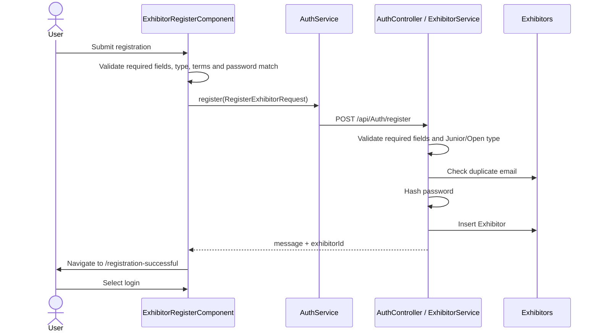

# Authentication and Registration

## Registration

`ExhibitorRegisterComponent` (`src\app\presentation\auth\register`) builds a reactive form containing:

| Field | Frontend validation |
|---|---|
| `firstName`, `lastName` | Required; each has `minLength(10)` |
| `email` | Required and email format |
| `phone` | Required, exactly 10 digits |
| `exhibitorType` | Required; only `Junior` or `Open` |
| `password` | Required, minimum 8 characters |
| `confirmPassword` | Required; group validator requires it to equal `password` |
| `terms` | `requiredTrue` |

On submit, the component lowercases/trims email and posts only `firstName`, `lastName`, `email`, `phone`, `exhibitorType`, `organization` (currently sent as an empty string), and `password`. Confirm-password and terms are not sent to the backend. Backend `RegisterExhibitorRequest` has no terms field. The API validates required fields and allowed type, checks duplicate email, hashes the password using `PasswordHasher<Exhibitor>`, inserts an `Exhibitor`, and returns the new id/message. It does not issue a JWT during registration. The UI navigates to `/registration-successful`, where the user can navigate to login.

The UI's 10-character minimum name rule is not mirrored by the backend. The visible Terms/Privacy anchors are `#` placeholders.



Registration does not automatically log in the new account; the user must use the login page to obtain a JWT.

## Login sequence

```mermaid
sequenceDiagram
    actor User
    participant Page as LoginPageComponent
    participant Auth as AuthService
    participant API as AuthController / AuthService
    participant DB as Exhibitors
    User->>Page: Submit email/password
    Page->>Page: Reactive form validation
    Page->>Auth: login(LoginRequest)
    Auth->>API: POST /api/Auth/login
    API->>DB: Find normalized email
    API->>API: Verify PasswordHasher hash; create signed JWT
    API-->>Auth: token, expiry, email, name, role, exhibitorType
    Auth->>Auth: Store tas-jwt and tas-user
    Auth-->>Page: LoginResponse
    Page->>Page: Read exhibitorType
    alt Junior
        Page->>User: Navigate /consent/junior
    else Open
        Page->>User: Navigate /consent/open
    else missing/unsupported
        Page->>User: Navigate /dashboard
    end
```

## JWT issuance and validation

`AuthService.LoginAsync` normalizes email, rejects blank credentials, loads the exhibitor, and verifies the stored hash. A successful token is signed with HMAC-SHA256. Claims include `sub` and email, full name, role `Exhibitor`, custom numeric `userId`, and `exhibitorType`. The response contains `token`, `expiresAtUtc`, `email`, `fullName`, `role`, and `exhibitorType`.

`Program.cs` configures JwtBearer to validate issuer, audience, lifetime, and signing key with a two-minute clock skew. The configured expiry is read from `JwtSettings:ExpiryMinutes` (default 120 in code/config). There is no custom refresh-token or explicit frontend expiration workflow.

## Browser storage and services

`AuthService` stores:

- `tas-jwt`: raw bearer token.
- `tas-user`: JSON with `email`, `fullName`, `role`, and `exhibitorType`.

Methods: `getToken()`, `getCurrentUser()`, `getExhibitorType()`, `isAuthenticated()`, and `logout()`. Invalid JSON in `tas-user` returns `null`; logout removes both keys and navigates to `/login`.

There is no configured `HttpInterceptor`. `ProfileService` and `ConsentService` create `Authorization` headers themselves. The consent service reads `tas-jwt` directly. The auth guard checks only whether `tas-jwt` is nonempty; it does not validate signature or expiry in the browser. The API remains the security boundary.

## Routes and account-type behavior

| Route | Guard | Behavior |
|---|---|---|
| `/login`, `/register`, `/registration-successful` | None | Public account flows |
| `/dashboard` | `authGuard` | Dashboard with current user's name/email/role |
| `/profile` | `authGuard` | Profile read/update |
| `/my-submissions` | `authGuard` | Current-account submissions and PDF action |
| `/consent/junior` | `authGuard` | Junior-specific consent |
| `/consent/open` | `authGuard` | Open consent |

The guard does not enforce Junior/Open route matching. A user can navigate to either guarded route manually; the backend enforces that a posted `ExhibitorType` matches the JWT claim.

## Errors and security notes

- Login validation errors are displayed inline; API/network login errors are reduced to “Invalid email or password.”
- Registration displays duplicate email (409), validation (400), offline (status 0), or generic server messages.
- JWT storage in `localStorage` is accessible to same-origin JavaScript and is therefore exposed if the app has an XSS flaw. No refresh-token flow, server-side revocation, or client expiry timer is implemented.
- The repository contains development JWT configuration/fallback values. Use a strong secret from protected deployment configuration and rotate it before production; do not use committed development values.
- The API emits only the `Exhibitor` role. There is no admin identity/authorization policy in the active flow.
