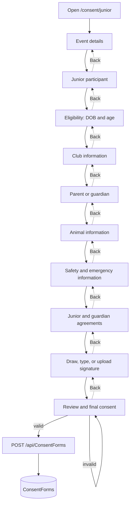
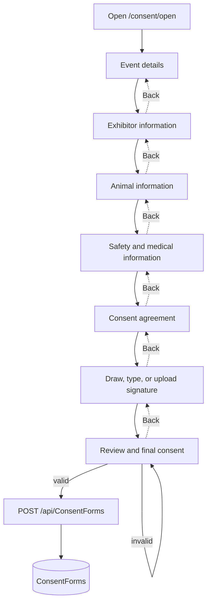

# Consent Form System

## Shared and page-specific components

`ConsentShellComponent` (`presentation\consent\shared\consent-shell`) renders the header, account chip, sidebar, stepper, projected page content, footer navigation, and logout. It accepts title, badge, steps, current step, and button state as inputs; `back` and `next` are output events.

`JuniorConsentFormComponent` and `OpenConsentFormComponent` each own their `FormGroup`, validation, step navigation, signature state, payload mapping, and API call. Both embed `DigitalSignatureComponent` and use `ConsentService`. They share visual section styles; Junior also reuses the Open consent stylesheet.

## Junior consent steps

The Junior component defines ten step labels; `stepGroupKeys` determines the validation group before advancing. “Next” marks the current step's group(s) touched and stays on that step if invalid. Step 9 requires separate participant and guardian signatures; step 10 submits. Back decrements the step number and does not discard the form.

| Step | Group/controls | Required validation and behavior |
|---|---|---|
| 1 Event Details | `event`: event name (default), location, date, organization | Location and date required |
| 2 Junior Exhibitor | `participant`: name, phone, email, address, city, state, ZIP | Name/address/city/state/ZIP required; phone if present must be 10 digits; email if present must be valid; ZIP 5 digits |
| 3 Junior Eligibility | `juniorEligibility`: DOB, age | DOB and Event Date determine age; the age field is read-only and recalculated on either date change; the DOB native date picker is bounded to eligible dates from the configured age rule; DOB cannot be future or after the Event Date |
| 4 Club Information | `club`: affiliation, club name, chapter number, county/district | Affiliation and club name required |
| 5 Parent / Guardian | `parentGuardian`: name, relationship, phone, email, address, city, state, ZIP | Name/relationship/phone/email required; phone 10 digits, email format; optional ZIP if supplied must be 5 digits |
| 6 Animal Information | `animal`: checkbox array for animal types, other type, name/ID, species, role, other role | Animal name, species, role required; checkbox array contains booleans; no validator requires an animal type selection |
| 7 Safety / Emergency | `safety` guidelines and agreement; `medical` allergies, assistance, emergency contact, hospital | Safety agreement required true; emergency contact name and 10-digit phone required |
| 8 Junior / Parent Consent | `consent`: generic agreement, parent/guardian consent, junior participation agreement, rules agreement | All four must be true |
| 9 Signature | `participantSignature` and `guardianSignature` signals | Both saved `SignatureResult` values are required to advance |
| 10 Review | `review`: participant acknowledgment and final consent | Both required true; final Next calls `submit()` |

`JuniorEligibility:MinAge` and `JuniorEligibility:MaxAge` in backend configuration remain the source of age limits. The form retrieves them from `GET /api/ConsentForms/junior-eligibility`; the configured rule is applied inclusively to age on the selected Event Date. Both the browser and API calculate age from DOB, including treating February 28 as the birthday for February 29 births in non-leap years. The API repeats the eligibility check and requires both signatures. Missing/invalid eligibility configuration returns a 503 configuration error.

## Open consent steps

The Open component defines seven steps:

| Step | Group/controls | Required validation and behavior |
|---|---|---|
| 1 Event Details | `event`: event name, location, date, organization | Location and date required |
| 2 Exhibitor Info | `exhibitor`: full name, DOB, age, phone, email, address, city, state, ZIP | Name/address/city/state/ZIP/phone/email required; phone 10 digits, email format, ZIP 5 digits; DOB and age optional |
| 3 Animal Info | `animal`: animal type boolean array, other type, name, species, role, other role | Animal name/species/role required; no array selection validator |
| 4 Safety & Medical | `safety`: guidelines/agreement; `medical`: allergies, assistance, emergency contact, hospital | Safety agreement and emergency name/10-digit phone required |
| 5 Consent | `consent.agree` | Required true |
| 6 Signature | `signature` signal | A saved signature result required |
| 7 Review | `review.finalConsent` | Required true; Next calls `submit()` |

The Open API path does not run the Junior-specific server validator. It still enforces authenticated user/type association and SQL persistence.

## Signature events and payload

Each page handles `(signatureSaved)` by updating its signature signal and `(signatureCleared)` by setting it to `null`. On Junior submit, the participant result is sent in `ParticipantSignatureMethod` / `ParticipantSignatureData`; the guardian result remains in the existing `SignatureMethod` / `SignatureData` fields for compatibility. Draw/upload signatures provide a data URL; typed signatures provide the name.

For Junior, page-side payload mapping includes Junior profile, guardian, and agreement fields. For Open, those are omitted/null. The browser sends `userId: ''`; the API replaces it with the authenticated identity and rejects a mismatched exhibitor type.

## Submission and persistence

`ConsentService.getJuniorEligibility()` reads the server-configured bounds from `GET /api/ConsentForms/junior-eligibility`. `ConsentService.submitConsentForm()` posts JSON to `http://localhost:5022/api/ConsentForms`, with a bearer header read from `tas-jwt`. Success navigates to `/my-submissions`.

`ConsentFormsController`:

1. requires authorization and obtains the authenticated identifier/type from JWT claims;
2. overwrites client `UserId` and verifies the submitted `ExhibitorType`;
3. validates Junior age computed from DOB on the Event Date, required participant/guardian signatures and agreement data, and removes Junior-only fields for Open;
4. sets `SubmittedAt` and `Status = "Submitted"`;
5. saves using `ApplicationDbContext.ConsentForms`.

The My Submissions view loads records for the signed-in account. Its action calls `POST /api/ConsentForms/{id}/approve`, which generates a PDF and sets the same record's status to `Approved`. This action is owner-scoped, not an admin review workflow.

## Junior and Open differentiation

Registration stores exactly `Junior` or `Open` in `Exhibitor.ExhibitorType`. Login puts that value into the response and JWT; `LoginPageComponent` chooses the initial route. Each form component also sends a fixed type value in its payload. The API treats the JWT claim as authoritative, compares the submitted type, and rejects a mismatch.
