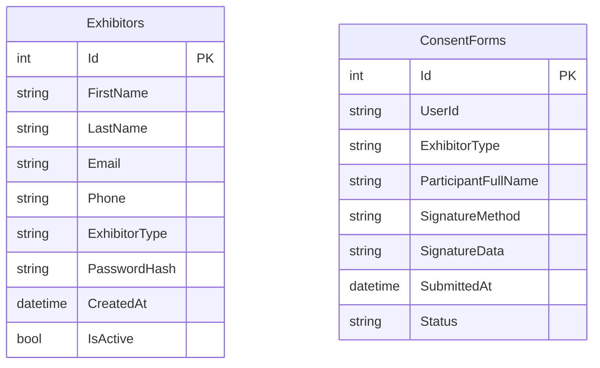
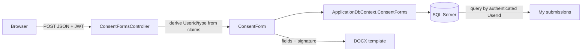

# Database Documentation

## Engine and configuration

`ApplicationDbContext` is an EF Core `DbContext`. The development connection string uses SQL Server LocalDB `(localdb)\MSSQLLocalDB` and database name `ElectronicSignature`, with Windows trusted connection. The API registers the context using `UseSqlServer` and `ConnectionStrings:DefaultConnection`.

The project includes EF migrations in `backend\ElectronicSignature.API\Migrations`. The inspected `Program.cs` does not invoke `Database.Migrate()`; apply the migrations explicitly in development. No live production database configuration is present in the workspace.

## Tables and relationships

This diagram deliberately shows no relationship line: `ConsentForm.UserId` is a string populated from the JWT name-identifier claim. The model has no navigation property and `ApplicationDbContext` configures no foreign key to `Exhibitors`. Account deletion/retention consistency is therefore not enforced by an EF relationship.

## `Exhibitors`

Entity: `Models\Exhibitor.cs`. The entity has integer `Id` primary key; required-by-default string properties `FirstName`, `LastName`, `Email`, `Phone`, `ExhibitorType`, and `PasswordHash`; optional `Organization`, address (`Address`, `City`, `State`, `Zip`), Junior DOB/age/club (`DateOfBirth`, `Age`, `ClubAffiliation`, `ClubName`, `ClubChapterNumber`, `CountyDistrict`), guardian name/relationship/phone/email; `CreatedAt` defaulting to UTC now; and `IsActive` defaulting true.

The registration service normalizes email to lowercase, stores the selected exhibitor type, hashes the password using `PasswordHasher<Exhibitor>`, and persists via `ExhibitorRepository`. There is no ASP.NET Identity user store in this data model.

## `ConsentForms`

Entity: `Models\ConsentForm.cs`. `Id` is the integer key. The remaining columns are organized as:

- Identity/type: `UserId`, `ExhibitorType`.
- Event: `EventName`, `EventLocation`, nullable `EventDate`, `Organization`.
- Participant: `ParticipantFullName`, nullable `DateOfBirth` and `Age`, `ParticipantPhone`, `ParticipantEmail`, `ParticipantAddress`, `ParticipantCity`, `ParticipantState`, `ParticipantZip`.
- Junior-specific nullable fields: `ClubAffiliation`, `ClubName`, `ClubChapterNumber`, `CountyDistrict`, parent/guardian name, relationship, phone, email, address, city, state, ZIP; nullable consent booleans `ParentGuardianConsent`, `JuniorParticipationAgreement`, `JuniorRulesAgreement`.
- Animal: `AnimalTypes`, `OtherAnimalType`, `AnimalName`, `Species`, `ExhibitorRole`, `OtherRole`.
- Safety/medical: `SafetyAgreed`, `Allergies`, `SpecialAssistance`, `EmergencyContactName`, `EmergencyContactPhone`, `PreferredHospital`.
- Consent/signature: `ConsentAgreed`, `SignatureMethod`, `SignatureData`, `FinalConsent`.
- Submission metadata: `SubmittedAt` default UTC now; `Status` default `"Submitted"`.

String properties are initialized to empty strings except nullable Junior fields. Open submission handling explicitly clears Junior-only fields. Signature data may be a sizeable data URL or a typed name; no separate signature blob store is configured.

## Other model and migrations

`Models\AppUser.cs` defines an `AppUser` model with id, email, full name, password hash, and role, but the active DbContext has no `AppUsers` DbSet and the active auth service uses `Exhibitor`; this class is not part of the demonstrated persistence flow.

Migration files present:

- `20260921063647_InitialCreate`
- `20260929060308_AddConsentForms`
- `20260929062645_AddConsentForm`
- `20260930095748_AddJuniorConsentFields`
- `20261001060654_AddExhibitorProfileFields`
- `ApplicationDbContextModelSnapshot`

The first migration creates Exhibitors; subsequent migrations add consent and later Junior/profile fields. No configured foreign-key relation between these tables is present in the model.

## Persistence flow

