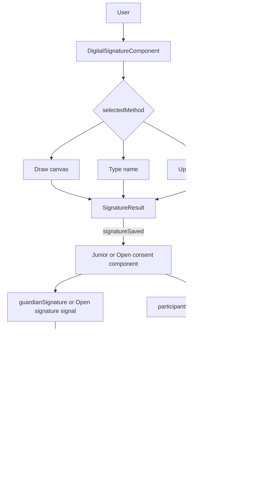
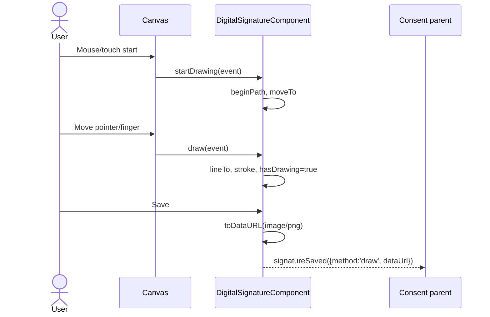
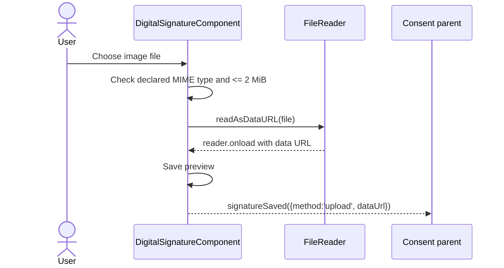

# Digital Signature Capture

## 1. Purpose and terminology

`DigitalSignatureComponent` is a reusable Angular UI for collecting a signature representation in one of three ways: draw on a canvas, type a name, or upload an image. Both Junior and Open consent pages embed the same standalone component, so capture behavior and output shape stay shared while each parent owns its own form and submission lifecycle.

**The current implementation is an electronic signature capture mechanism, not a certificate-based cryptographic digital signature.** It captures a visible mark or typed name and passes it to the consent form. It does not prove who created it or cryptographically bind it to a document.

## 2. Source files and component contract

| File | Responsibility |
|---|---|
| `frontend\electronic-signature-ui\src\app\presentation\consent\shared\digital-signature\digital-signature.component.ts` | Types, inputs/outputs, state, canvas, typed entry, upload validation and events |
| `frontend\electronic-signature-ui\src\app\presentation\consent\shared\digital-signature\digital-signature.component.html` | Method selector, conditional panels, canvas, name input, file selector and previews |
| `frontend\electronic-signature-ui\src\app\presentation\consent\shared\digital-signature\digital-signature.component.css` | Card/panel layout, responsive method selector, canvas, buttons and previews |
| `frontend\electronic-signature-ui\src\app\presentation\consent\junior\junior-consent-form.component.ts` | Receives participant and guardian results into independent signals, maps both to the Junior request and submits |
| `frontend\electronic-signature-ui\src\app\presentation\consent\open\open-consent-form.component.ts` | Receives signature into `signature`, maps it to Open request and submits |
| `frontend\electronic-signature-ui\src\app\core\services\consent.service.ts` | Serializes `ConsentForm` JSON and sends it to the API |
| `backend\ElectronicSignature.API\Models\ConsentForm.cs` | Persists the existing guardian `SignatureMethod` and `SignatureData` plus participant signature fields |

The child has two configurable inputs: `heading` and `description`. Its output events are `signatureSaved: EventEmitter<SignatureResult>` and `signatureCleared: EventEmitter<void>`. Its internal state is represented by Angular Signals.

```ts
type SignatureMethod = 'draw' | 'type' | 'upload';

interface SignatureResult {
  method: SignatureMethod;
  dataUrl: string;
  fullName?: string;
}
```

`selectedMethod` starts as `draw`; `hasDrawing`, `isSaved` start false; `typedName` and `uploadError` start empty; `uploadedPreview` starts null. `canvasRef` is a `ViewChild<ElementRef<HTMLCanvasElement>>`; `ctx` is a nullable `CanvasRenderingContext2D`; `isDrawing` is a private pointer-state boolean.

## 3. Showing exactly one capture panel

The three method buttons call `selectMethod('draw' | 'type' | 'upload')`. The template renders method-specific interface sections with mutually exclusive `*ngIf` checks on `selectedMethod()`:

- `draw` displays the canvas and Clear/Save buttons;
- `type` displays the full-name field and typed preview;
- `upload` displays the file input or its image preview/error.

The selector remains visible, but only the active capture panel is in the DOM. That reduces clutter and gives the user a clear current input path. `selectMethod` clears the child `isSaved` indicator and reinitializes the canvas after a draw panel is recreated. It does **not** clear the parent’s saved value or emit `signatureCleared`; callers should account for this current behavior.

## 4. Draw capture: canvas lifecycle and rendering

`ngAfterViewInit()` calls `setupCanvas()` once the canvas reference exists. `setupCanvas()` gets the 2D context and configures a 2.5-pixel line width, round caps/joins, and `#1f2d3d` stroke color. When the user switches back to Draw, the `*ngIf` may have created a new canvas; `selectMethod()` schedules another setup with `setTimeout`. `ngOnDestroy()` stops drawing and releases the context reference.

The template gives the canvas an intrinsic size of `760 × 220`; CSS makes it responsive (a displayed height of 280 px by default, with breakpoints). `getCanvasPoint()` reads `getBoundingClientRect()`, then calculates:

```text
scaleX = canvas.width / rect.width
scaleY = canvas.height / rect.height
x = (clientX - rect.left) * scaleX
y = (clientY - rect.top) * scaleY
```

The offset converts browser viewport coordinates to canvas-local coordinates. The scaling converts CSS/display pixels to intrinsic canvas pixels, which keeps strokes aligned when the canvas is resized responsively. No device-pixel-ratio scaling is applied.

### Mouse and touch behavior

The template wires `mousedown`, `mousemove`, `mouseup`, and `mouseleave` to `startDrawing`, `draw`, and `stopDrawing`. Touch uses `touchstart`, `touchmove`, `touchend`, and `touchcancel`. CSS sets `touch-action: none` on the canvas. `getCanvasPoint()` reads `clientX/clientY` from a mouse event or the first available touch in `touches`/`changedTouches`.

1. `startDrawing()` requires a context, calls `preventDefault()`, marks `isDrawing = true`, computes a point, and calls `beginPath()` / `moveTo()`.
2. While active, `draw()` prevents default browser behavior, computes the next point, calls `lineTo()` then `stroke()`, sets `hasDrawing = true`, and clears the saved indicator.
3. `stopDrawing()` prevents default when it has an event, clears `isDrawing`, and closes the path.
4. `clearDrawing()` clears the entire intrinsic canvas rectangle, resets the drawing flags, and emits `signatureCleared`.
5. `saveDrawnSignature()` returns early if the canvas is absent or no movement has set `hasDrawing`; otherwise it calls `canvas.toDataURL('image/png')` and emits `{ method: 'draw', dataUrl }`.

`toDataURL('image/png')` returns a `data:image/png;base64,...` string encoding a raster image of the canvas pixels. This string—not drawing vectors or a signed document—is the value submitted. A mouse/touch press without a move does not set `hasDrawing`, so the save button remains disabled for a click/tap-only mark.

## 5. Typed signature

The text input uses `[ngModel]="typedName()"` and `(ngModelChange)="onTypedNameChange($event)"`. The handler updates the `typedName` signal and marks the child as not saved. The template shows the entered name as a cursive-style preview. `saveTypedSignature()` trims the name and returns if it is empty; otherwise it emits:

```json
{
  "method": "type",
  "dataUrl": "",
  "fullName": "Example Name"
}
```

The name is ordinary user-entered text; the preview font is CSS presentation, not a generated image or identity check. The parent stores the object. At submission, both forms map `dataUrl || fullName || ''` into `ConsentForm.signatureData`, so the database value for this method is the typed name, while `signatureMethod` remains `"type"`.

## 6. Uploaded signature

The hidden file input uses `accept="image/png,image/jpeg,image/jpg"` and calls `onFileSelected($event)`. The component:

1. clears the previous `uploadError`;
2. casts the event target to `HTMLInputElement` and reads the first `File`;
3. checks `file.type` against `image/png`, `image/jpeg`, and `image/jpg`;
4. rejects sizes greater than `2 * 1024 * 1024` bytes (2 MiB);
5. creates a `FileReader` and calls `readAsDataURL(file)`;
6. in `reader.onload`, treats `reader.result` as a string, stores it in `uploadedPreview`, marks saved, and emits `{ method: 'upload', dataUrl: result }`.

The preview is rendered as an `` using that data URL. `removeUploadedSignature()` clears preview/error/saved state and emits `signatureCleared`.

**Validation boundary:** the HTML `accept` attribute is a chooser hint; MIME type and size checks happen in the browser and are not a server-side security guarantee. There is no explicit `FileReader.onerror` handler, server-side MIME/content sniffing, image decoding constraint, or independent API size limit visible in the inspected implementation.

## 7. Parent-child event flow and persistence



The component output names remain `(signatureSaved)` and `(signatureCleared)`. Junior binds them independently for the participant and guardian, and clearing one resets only that signal. The guardian continues using `SignatureMethod` / `SignatureData`; new nullable participant columns preserve the participant method and data. Open continues using the original fields only. The API requires both Junior signatures and the PDF renderer inserts each in its matching signature block.

### Draw sequence



### Type sequence

```mermaid
sequenceDiagram
    actor User
    participant D as DigitalSignatureComponent
    participant P as Consent parent
    User->>D: Type name
    D->>D: onTypedNameChange; update signal
    User->>D: Save Signature
    D->>D: Trim and validate nonempty name
    D-->>P: signatureSaved({method:'type', dataUrl:'', fullName})
```

### Upload sequence



## 8. Comparison

| Feature | Draw | Type | Upload |
|---|---|---|---|
| Input | Mouse/touch/stylus movement on canvas | Full name text | Local image file |
| Result | PNG canvas data URL | `fullName`; empty `dataUrl` | FileReader data URL |
| Preview | Live canvas | Cursive CSS text | `` preview |
| Checks | Canvas exists and movement recorded | Trimmed value nonempty | Declared MIME allow-list; max 2 MiB |
| Main methods | `setupCanvas`, `getCanvasPoint`, `startDrawing`, `draw`, `stopDrawing`, `clearDrawing`, `saveDrawnSignature` | `onTypedNameChange`, `saveTypedSignature` | `onFileSelected`, `removeUploadedSignature` |
| Benefit | Freehand visual mark | No image upload needed | Reuse a pre-existing signature image |
| Limit | Raster only; movement required to count as drawing | Text is not a handwriting image or identity proof | Client-side checks only; submitted data URL can be large |

## 9. State, error handling, and current limitations

- `isSaved` is a child presentation flag. It is not a formal parent validity contract and is reset on method selection.
- `selectMethod()` does not emit a clear event. If a user has already saved a result and switches methods, the parent can retain the old result while the child shows a different method. A further save replaces it; a clear action emits the clear event.
- `hasDrawing` is not reset when changing to another method; it is reset by Clear.
- Upload errors are displayed inline for rejected MIME/size. Reader failures are not handled.
- Parent forms require a non-null result. Junior backend checks both signature method/data pairs; typed names satisfy that data requirement. The Open server path does not apply this Junior-specific signature validation.
- The database stores signature data as a string. A PNG/JPEG data URL may be large; no image object storage or signature-specific server cap is established in the inspected code.

## 10. Security and legal/cryptographic limits

The current code creates a visual representation and sends a name/image data string with a consent record. It does not implement identity verification beyond the account JWT, a certificate, public/private-key signing, PKI, document hashing, cryptographic binding between a document and signature, tamper detection, or non-repudiation. It does not establish that the signature is legally qualified.

Data URLs are encoding, not encryption. HTTPS should protect requests in transit in deployment; database access controls and encryption-at-rest must be configured operationally. JWTs are stored in `localStorage`, which increases the impact of XSS. Validate authorization on the server and do not rely on hidden controls or client checks. Upload checks must be repeated on the server (size, decoded content, allowed format, and safe handling) before accepting untrusted file data. Avoid rendering arbitrary untrusted data URLs; constrain accepted schemes/content.

For a stronger audit-grade workflow, a future design could add server-side image validation and size limits, signer/guardian identity verification, immutable consent version and timestamp/audit metadata, a document hash, a certificate-based signing provider, and a verification process. These are recommendations, not current features.
