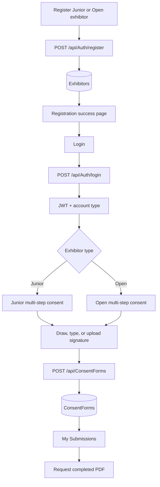

# Project Documentation

## Purpose and status

**Project:** ElectronicSignature / Texas Youth Animal Showcase exhibitor portal.

The repository implements an exhibitor-facing web portal for creating accounts, editing exhibitor profiles, completing Junior or Open consent forms, capturing an electronic signature, viewing saved submissions, and producing a completed PDF on request. The code does not establish a broader business policy or organizational role model beyond the exhibitor workflows described here.

## Plain-language system description

An exhibitor registers and logs in. Their account type is returned at login; Junior and Open accounts are routed to different consent forms. The form is validated in the browser, the signature result is included in a JSON request, and the API associates and persists the submission under the authenticated account. The portal can retrieve that account's submissions and request a filled consent PDF.

## Technical overview

- **Frontend:** Angular 22 standalone application, TypeScript 6, Reactive Forms, Angular Router, Signals, RxJS, and `HttpClient`.
- **Backend:** ASP.NET Core Web API targeting `net10.0`; controllers call services/repositories and/or `ApplicationDbContext`.
- **Database:** SQL Server configured for LocalDB in development, accessed through EF Core and migrations.
- **Authentication:** the API verifies password hashes and issues a signed JWT. Angular stores it in browser `localStorage` and manually supplies bearer headers for protected HTTP requests.
- **PDF:** DOCX templates in `Assets` are filled from stored consent records; Microsoft Word automation exports the DOCX as a PDF on Windows.

See [ARCHITECTURE.md](ARCHITECTURE.md), [AUTHENTICATION.md](AUTHENTICATION.md), [CONSENT_FORM.md](CONSENT_FORM.md), and [DATABASE_DOCUMENTATION.md](DATABASE_DOCUMENTATION.md) for detail.

## User roles and access as implemented

The backend emits the JWT role claim `Exhibitor`. Junior and Open are **exhibitor types**, not separate authorization roles. No admin role or admin controller is implemented in the inspected API.

Unauthenticated routes: `/login`, `/register`, `/registration-successful`. `authGuard` protects `/dashboard`, `/profile`, `/my-submissions`, `/consent/junior`, and `/consent/open` by checking for a nonempty `tas-jwt` value. API authorization independently validates the JWT.

Registration accepts `Junior` or `Open`, hashes the password, and persists the exhibitor. Login retrieves the type from the stored account and returns it in the response and JWT. The frontend routes by this response; server-side consent submission separately verifies that the posted type matches the JWT claim.

## Primary user journey



The final step calls `POST /api/ConsentForms`; the success handler navigates to `/my-submissions`. The database stores submissions. There is no separate “save draft” path in the documented consent flow.

## Key features

| Feature | Status |
|---|---|
| Registration, login, JWT, logout | Implemented |
| Junior/Open type selection and routing | Implemented |
| Profile read/update | Implemented |
| Junior and Open consent forms | Implemented; different sections, field sets, and validation |
| Draw/type/upload signature capture | Implemented as electronic capture |
| Consent persistence and per-account submission listing | Implemented |
| Consent PDF generation and download | Implemented with a Windows/Microsoft Word runtime dependency |
| Admin review, role-based approval, password reset, Google login | Not implemented in the inspected code |
| Certificate-based signing, document hashing, signature audit trail | Not implemented |

See [DIGITAL_SIGNATURE.md](DIGITAL_SIGNATURE.md) for the exact signature data contract and security limits.

## Project structure

```text
Assets\
  Texas_Youth_Animal_Showcase_*_Consent_Form_Template.docx
  *.png and a login design prompt
backend\
  ElectronicSignature.API\
    Data\                         DbContext and exhibitor repository
    Migrations\                   EF Core migration history
    Models\                       Exhibitor, ConsentForm, AppUser
    Online\Controllers\            Auth, exhibitor profile, consent APIs
    Online\DTOs\                   Request/response contracts
    Online\Services\               Auth, exhibitor, PDF services
    Program.cs
frontend\
  electronic-signature-ui\
    src\app\                       Standalone components, services, routes
    src\environments\
    public\
  cdk-drag-drop-practice\          Separate practice Angular project
docs\
graphify-out\                      Generated knowledge graph artifacts
```

## Technologies

| Technology | Use in this repository |
|---|---|
| Angular / TypeScript | Standalone UI, routing, component state, forms |
| Reactive Forms | Login, registration, profile, and consent form validation |
| Signals | Component-local UI and signature state |
| RxJS | `HttpClient` observables and login/submission handlers |
| ASP.NET Core | API controllers, middleware, JWT auth |
| EF Core / SQL Server | Exhibitor and consent persistence |
| JWT | Authenticated API requests |
| HTML Canvas / FileReader | Drawn signature image and uploaded signature data URL |
| Open XML / Word COM | Template filling and PDF export |

## Implementation cautions

- The frontend registration has a 10-character minimum for first and last names; the API requires those fields to be nonblank but does not impose the same minimum.
- Password reset and Google sign-in controls in the login template are presentation-only links/buttons.
- The service named `ApproveSubmission` is exposed to authenticated users and limits access to their own submissions; there is no separate administrator approval permission.
- The login guard does not decode or expire JWTs in the browser.
- Development JWT material is present in project configuration/fallback code; production secrets must be supplied outside source control.

